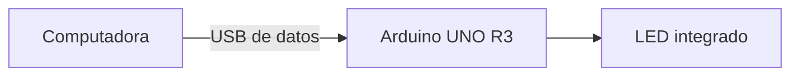

# Arduino: tu primer programa y el LED integrado

**Por Ernesto Leal · Halifar Electronic Tech**

Objetivo: comprender `setup`, `loop` y una salida digital. Placa de referencia: Arduino UNO R3. Estas prácticas usan su LED integrado y no requieren resistencias ni cableado externo.

## Materiales y conexiones

Arduino UNO R3, cable USB de datos, computadora con Arduino IDE y paquete de soporte de la placa. Conecta únicamente el USB. El programa utiliza `LED_BUILTIN`; no traslades el ejemplo a otra placa sin revisar cómo funciona su LED.

## Preparación

Abre el archivo `.ino` de una versión; la carpeta y el archivo tienen el mismo nombre. Selecciona la placa y el puerto, pulsa Verificar y después Cargar. No cargues las tres versiones a la vez: cada carga sustituye el programa anterior.

## Tres versiones explicadas

### Esencial: LED encendido

[Código](nivel-1/led_encendido/led_encendido.ino). `setup` se ejecuta una vez. `pinMode` configura la salida y `digitalWrite` la coloca en HIGH. `loop` queda vacío. Resultado esperado: LED integrado encendido.

### Ampliada: parpadeo

[Código](nivel-2/parpadeo/parpadeo.ino). `loop` se repite: enciende, espera 500 ms, apaga y vuelve a esperar. `delay` detiene la ejecución del programa durante cada espera. Resultado esperado: medio segundo encendido y medio segundo apagado.

### Reto: parpadeo sin detener el programa

[Código](nivel-3/parpadeo_sin_bloqueo/parpadeo_sin_bloqueo.ino). `millis` permite consultar el tiempo transcurrido. Guardamos el instante del último cambio y solo invertimos el estado al cumplirse el intervalo. La resta con valores `unsigned long` permite manejar el desbordamiento del contador. El resto de `loop` puede atender otras tareas; aquí aún no añadimos ninguna.

Este reto introduce tiempo y estado: puedes volver a él después de estudiar variables y condicionales. No es requisito para continuar.

## Modifica una cosa

Cambia 500 por 1000 en la versión ampliada y observa el ritmo. Después cambia `intervalo` en el reto.

## Validación

Las tres versiones compilaron para `arduino:avr:uno` con Arduino CLI 1.5.1 y Arduino AVR Boards 1.8.8 el 18 de octubre de 2026. La prueba en una placa física sigue pendiente. Los comportamientos indicados son resultados esperados, no mediciones realizadas.

## Fuentes

- [Blink, documentación Arduino](https://docs.arduino.cc/built-in-examples/basics/Blink/).
- [Blink Without Delay](https://docs.arduino.cc/built-in-examples/digital/BlinkWithoutDelay/).

## Sigue aprendiendo

[Instagram](https://www.instagram.com/halifarelectronictech/) · [Facebook](https://www.facebook.com/halifarelectronictech/) · [Biblioteca](https://github.com/Halifarelectronic/halifar-electronic-tech)

© 2026 Ernesto Leal · Halifar Electronic Tech.
