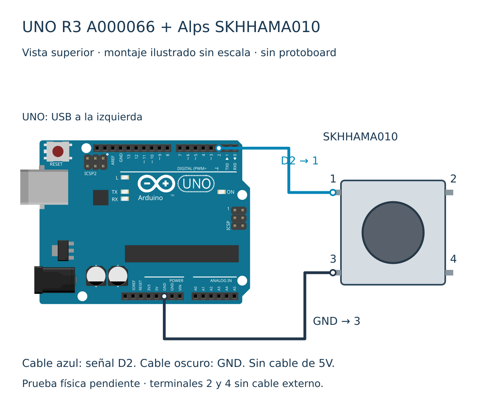

# Entradas digitales y pulsadores

Pregunta: ¿cómo leer un pulsador sin dejar una entrada flotante?
[Anterior: Monitor serie](../003-monitor-serie/README.md). Prerrequisitos: setup/loop, variables, operadores, Monitor serie y LED integrado. Aquí se introduce bool y la comparación ==, sin usar condicionales.

## Materiales y versiones

Arduino UNO R3 A000066 con ATmega328P, pulsador Alps Alpine **SKHHAMA010**, cable USB de datos y dos cables con extremos adecuados para conectar o soldar a los terminales del pulsador con aislamiento. No insertar este modelo forzadamente en una protoboard ni sustituirlo por un pulsador de cuatro patas sin comprobar su ficha. Core Arduino AVR 1.8.6; placa `arduino:avr:uno`. No hay bibliotecas adicionales.

## Montaje

Vista superior del SKHHAMA010: 1 arriba izquierda, 2 arriba derecha, 3 abajo izquierda y 4 abajo derecha, según dibujo del fabricante. 1 y 2 forman un contacto; 3 y 4 el otro. Pulsar une los contactos. Con USB retirado conecta **D2 al terminal 1** y **GND al terminal 3**. Terminales 2 y 4 quedan sin cable externo. Verifica orientación con el dibujo oficial y continuidad con multímetro antes de energizar. Los números se asignan según la ficha, no están necesariamente grabados en el plástico.

La resistencia pull-up interna del ATmega328P lleva D2 al nivel alto de la placa (5 V) al soltar. Al pulsar, la entrada se conecta a GND a través del contacto; la pull-up limita la corriente. No conectar un cable de 5V al pulsador. Solo se alimenta el UNO mediante USB: sin VIN, fuente adicional, LED externo o condensador requerido. Se conserva el desacoplo de la placa. [Redes y terminales editables](diagramas/conexiones.json).

## Instalación y ejecución

Abre `nivel-1/nivel-1.ino` en Arduino IDE, selecciona Arduino UNO y el puerto que corresponda a tu placa, carga y abre el Monitor serie a 9600 baudios. Repite con cada carpeta. Alternativa CLI: `arduino-cli compile --fqbn arduino:avr:uno nivel-1`. La configuración del puerto depende de tu equipo.

## Tres ejemplos explicados

1. **Esencial:** pinMode activa INPUT_PULLUP; digitalRead entrega HIGH o LOW y Serial.println muestra 1 suelto y 0 pulsado. Una entrada sin pull-up puede fluctuar: no cambies a INPUT para esta conexión.
2. **Ampliado:** `(digitalRead(BOTON) == LOW)` es una comparación. Se guarda en un bool: true significa pulsado, no el nivel eléctrico alto. La salida pasa a 1 pulsado y 0 suelto.
3. **Reto:** se configura LED_BUILTIN como salida y se le entrega el booleano. En el UNO R3 el LED incorporado se ilumina al pulsar. No se añade ningún LED externo.

El delay de 100 ms hace legible el seguimiento; **no elimina rebotes** ni garantiza capturar pulsos breves. No contar pulsaciones con esta práctica. Antirrebote y detección de flancos se estudiarán más adelante.

## Validación y diagnóstico

Los tres sketches se compilan para UNO R3; [registro](pruebas/compilacion.txt). Revisión documental del pinout, terminales y redes; **prueba física pendiente**. No se midieron rebotes, corriente ni tensión reales. Si siempre ves 1, revisa GND, el terminal y el contacto; si siempre ves 0, busca un corto D2-GND. Texto ilegible: comprueba 9600 baudios. Desconecta USB antes de corregir.

Ejercicio: predice qué imprime cada nivel al pulsar y soltar, y compara con tu montaje. Siguiente previsto: condicionales.

Fuentes oficiales consultadas el 8 de noviembre de 2026:
- https://tech.alpsalpine.com/e/products/detail/SKHHAMA010/
- https://docs.arduino.cc/resources/pinouts/A000066-full-pinout.pdf
- https://docs.arduino.cc/built-in-examples/digital/InputPullupSerial/
- https://docs.arduino.cc/language-reference/en/functions/digital-io/pinMode/

La representación del UNO procede de Fritzing, parte arduino_Uno_Rev3 (althaus, versión 5); se conserva su atribución. Diagrama derivado distribuido bajo CC BY-SA 3.0. Referencia oficial Arduino del pinout: CC BY-SA 4.0, enlazada sin modificar.

Por Ernesto Leal · Halifar Electronic Tech.

[Instagram](https://www.instagram.com/halifarelectronictech/) · [Facebook](https://www.facebook.com/halifarelectronictech/) · [Índice](../../README.md)
