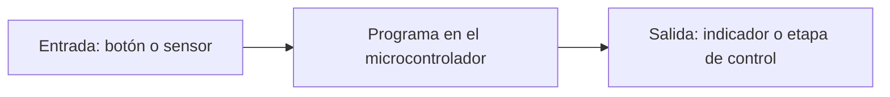
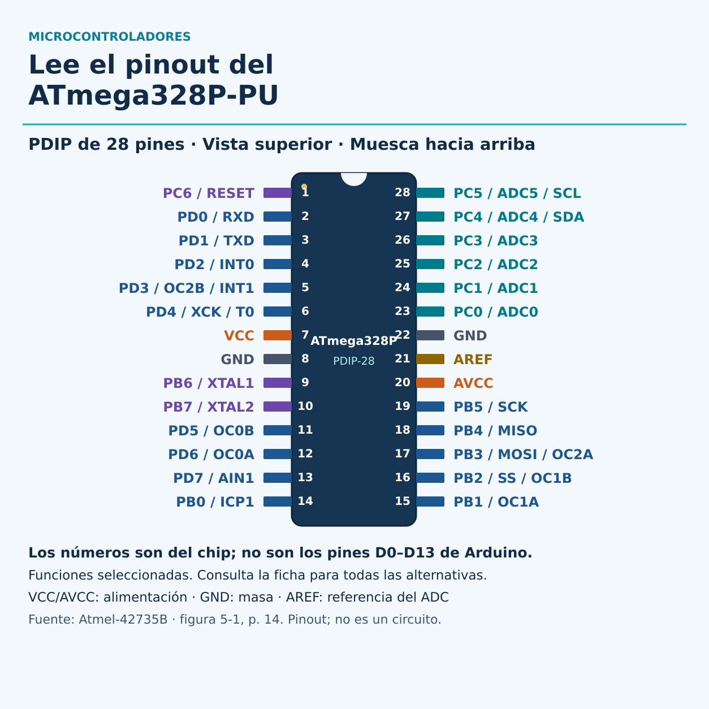

# Qué es un microcontrolador

**Por Ernesto Leal · Halifar Electronic Tech**

Un microcontrolador es un circuito integrado que reúne un procesador, memoria y periféricos para ejecutar un programa y relacionarse con otros dispositivos.

## Una idea sencilla

Imagina una tarea: leer un botón y encender una luz. Una entrada recibe el estado del botón, el programa decide qué hacer y una salida cambia el estado de la luz mediante el circuito adecuado.

El dibujo representa funciones, no cableado.

## Qué contiene

- Procesador: ejecuta instrucciones.
- Memoria: conserva programa y datos según el tipo de memoria.
- GPIO: pines configurables como entradas o salidas.
- Periféricos: pueden incluir temporizadores, ADC y buses de comunicación; dependen del modelo.

## Chip, placa y pinout

El microcontrolador es el chip. Una placa de desarrollo añade elementos para alimentarlo, programarlo y acceder a sus conexiones. Su pinout muestra las señales disponibles y debe corresponder al modelo y revisión exactos. El nombre de un pin del chip no siempre coincide con el rótulo de la placa.

## Práctica

Busca el modelo escrito en tu placa y el del chip principal. Anota por separado ambos nombres y localiza su documentación oficial. En esta lección no hace falta conectar componentes ni ejecutar código.

## Sigue aprendiendo

[Instagram](https://www.instagram.com/halifarelectronictech/) · [Facebook](https://www.facebook.com/halifarelectronictech/) · [Biblioteca](https://github.com/Halifarelectronic/halifar-electronic-tech)

© 2026 Ernesto Leal · Halifar Electronic Tech.

## Ejemplo: ATmega328P-PU

El ATmega328P integra CPU AVR de 8 bits, 32 KB de Flash para el programa, 2 KB de SRAM para datos de trabajo y 1 KB de EEPROM para datos persistentes. La placa Arduino UNO R3 añade alimentación, comunicación USB y otros componentes alrededor del microcontrolador. Un chip suelto no funciona como una placa conectada por USB.

### Cómo leer su pinout

Observa la muesca arriba: el pin 1 está arriba a la izquierda. La numeración desciende por la izquierda hasta 14 y continúa por la derecha desde 15 abajo hasta 28 arriba. Este dibujo es del encapsulado **PDIP-28**; no lo uses para TQFP ni para otro microcontrolador. Los números físicos del chip no son los números digitales de la placa Arduino. Se muestran funciones alternativas seleccionadas, no todas. El archivo [pinout.json](diagramas/pinout.json) permite consultar la correspondencia.

VCC es la alimentación digital, AVCC alimenta el ADC y el puerto C, y ambos GND son masa. AREF es la referencia del ADC, no un pin de alimentación de uso general. RESET reinicia el chip. RXD/TXD corresponden a UART, SDA/SCL al bus TWI compatible con I²C y MOSI/MISO/SCK/SS a SPI. No conectes señales por el nombre de un protocolo sin comprobar niveles y configuración.

### Práctica de lectura, sin alimentación

Localiza GND, RESET, RXD y SDA en el dibujo. Respuestas: 8/22, 1, 2 y 27. Después identifica el chip y la placa en una imagen del UNO R3. No hace falta comprar componentes ni montar un circuito para esta lección.

### Límites y validación

El pinout se contrastó con la figura 5-1 de la ficha Atmel-42735B, página 14. No es un diagrama de conexión, ni un circuito mínimo, ni una prueba física. Un montaje necesita además estudiar alimentación, desacoplo, reloj, reset y programación. No se entrega un programa en esta lección de identificación. Microchip clasifica actualmente el ATmega328P como no recomendado para diseños nuevos; aquí sirve de referencia educativa.

### Fuentes

- [Ficha del fabricante, alojada por Arduino](https://docs.arduino.cc/resources/datasheets/Atmel-42735-8-bit-AVR-Microcontroller-ATmega328-328P_Datasheet.pdf), figura 5-1 y características iniciales.
- [Página del producto en Microchip](https://www.microchip.com/en-us/product/ATMEGA328P), estado del dispositivo.
