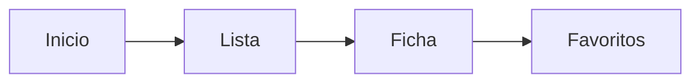

# Mi laboratorio: la app que vamos a construir

**Por Ernesto Leal · Halifar Electronic Tech**

Una app es un programa con pantallas y acciones. En este recorrido crearás **Mi laboratorio**: una pequeña biblioteca de componentes y proyectos electrónicos.

## Problema que resuelve

Consultar qué hace un componente, encontrar una explicación y conservar favoritos. La primera versión utilizará fichas locales de ejemplo; no medirá sensores ni controlará dispositivos.

## Pantallas iniciales

- Inicio: categorías y una forma sencilla de buscar.
- Lista: componentes de una categoría.
- Ficha: nombre, descripción y acceso al recurso.
- Favoritos: las fichas que quieras consultar después.

## Práctica sin programar

Dibuja las cuatro pantallas en papel. Decide qué botón te lleva de una a otra y qué mostrarías si no hay favoritos. Usa texto claro, buen contraste y botones fáciles de pulsar. No comuniques una acción solo mediante color.

## Qué aprenderás antes de escribir la app

Variables, funciones y datos de JavaScript; después TypeScript, componentes y estado. Cada término se explicará antes de utilizarlo.

## Resultado de esta etapa

Un objetivo concreto y un boceto de navegación. No se instala software ni se entrega una app ejecutable en este tema.

[Continúa con la ruta del curso](../../README.md).

## Sigue aprendiendo

[Instagram](https://www.instagram.com/halifarelectronictech/) · [Facebook](https://www.facebook.com/halifarelectronictech/) · [Biblioteca](https://github.com/Halifarelectronic/halifar-electronic-tech)

© 2026 Ernesto Leal · Halifar Electronic Tech.
