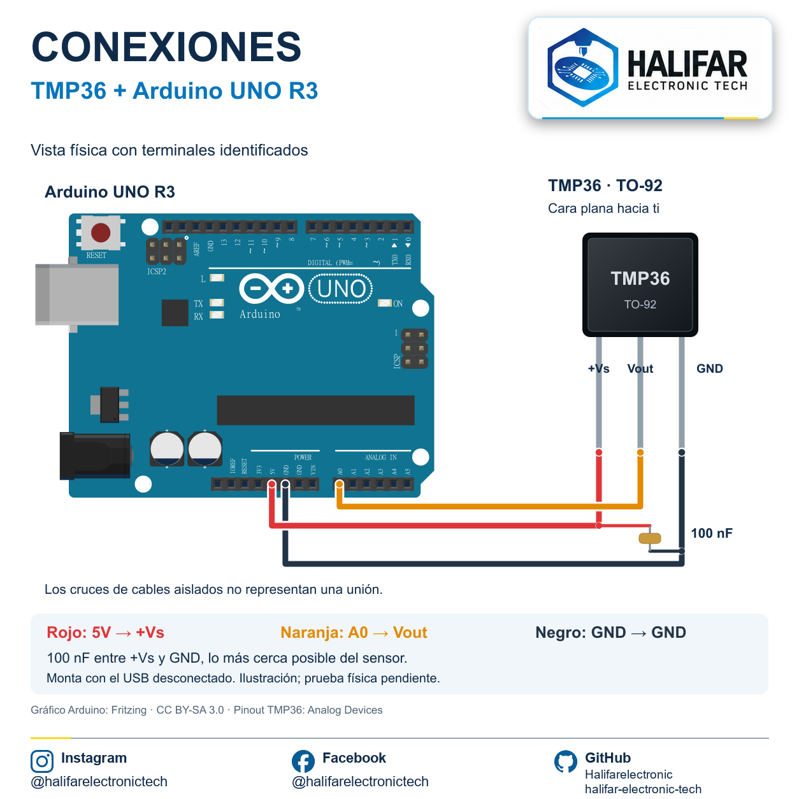

# TMP36 con Arduino UNO R3

**Por Ernesto Leal · Halifar Electronic Tech**

El TMP36 convierte temperatura en tensión analógica. Aprenderás a leer A0, convertir la lectura a grados Celsius y aplicar un umbral educativo al LED integrado. Utiliza el sensor TMP36 suelto, encapsulado TO-92; no es un LM35 ni un módulo de otro fabricante.

## Materiales

- Arduino UNO R3 y cable USB de datos.
- TMP36 TO-92, cables de conexión y soporte que mantenga separadas sus patas.
- Condensador cerámico de 100 nF para desacoplo entre +Vs y GND, junto al sensor.
- Arduino IDE y soporte Arduino AVR Boards.

## Características relevantes

Alimentación de 2.7 a 5.5 V, salida analógica con escala de 10 mV/°C y desplazamiento de 0.5 V a 0 °C. Una salida ideal de 0.75 V representa 25 °C. Estas cifras describen la transferencia nominal y no eliminan el error del sensor o del ADC.

## Conexiones

Con la cara plana del TMP36 hacia ti y las patas hacia abajo: izquierda +Vs, centro Vout, derecha GND. La ficha representa el encapsulado también mediante una vista inferior: no intercambies las orientaciones.

| Arduino UNO R3 | TMP36 TO-92 | Cable |
|---|---|---|
| 5V | +Vs, pata izquierda en la vista descrita | Rojo |
| A0 | Vout, pata central | Naranja |
| GND | GND, pata derecha | Negro |

El condensador de 100 nF conecta +Vs con GND cerca del sensor. No se conecta a Vout. Desconecta el USB para montar o modificar cables; comprueba que las patas no hagan contacto entre sí.

La imagen es una ilustración del montaje, no una fotografía ni una prueba física. Sus cables corresponden a terminales definidos y a la tabla. Consulta también el [diagrama editable](diagramas/conexion-tmp36.svg) y la [lista de conexiones](diagramas/conexiones.json).

El gráfico de Arduino utiliza la biblioteca de piezas de Fritzing, autor de la pieza: althaus. El diagrama derivado se distribuye bajo CC BY-SA 3.0: https://creativecommons.org/licenses/by-sa/3.0/ . Fuentes: https://github.com/fritzing/fritzing-parts/blob/develop/core/arduino_Uno_Rev3(fix).fzp y https://github.com/fritzing/fritzing-parts/blob/develop/svg/core/breadboard/arduino_Uno_Rev3_breadboard.svg . Las marcas pertenecen a sus titulares.

## Instala y ejecuta

Abre una sola versión, selecciona Arduino UNO y su puerto, verifica y carga. Abre el monitor serie a 9600 baudios. Cambiar de versión sustituye el programa cargado. No necesitas bibliotecas externas.

| Versión | Archivo | Qué aprendes |
|---|---|---|
| Esencial | [Lectura ADC](nivel-1/leer_adc/leer_adc.ino) | Leer y observar A0 |
| Ampliada | [Temperatura](nivel-2/temperatura/temperatura.ino) | Convertir tensión a °C |
| Reto | [Aviso con LED](nivel-3/aviso_led/aviso_led.ino) | Aplicar una condición y controlar una salida |

## Código explicado

`analogRead(A0)` devuelve una lectura del ADC. En esta práctica se aproxima la tensión mediante `lectura * 5.0 / 1024.0` para el ADC de 10 bits del UNO R3. El 5.0 representa una referencia nominal: la alimentación real puede diferir y afectar el resultado. La temperatura se estima con `(voltaje - 0.5) * 100.0`.

El reto compara la temperatura con 30 °C y enciende el LED integrado cuando alcanza o supera ese valor. Es un umbral arbitrario para practicar, no una recomendación de protección térmica. `delay(1000)` simplifica este primer ejemplo y bloquea durante la espera.

## Resultado esperado

La versión esencial imprime un entero. La ampliada imprime una temperatura estimada. El reto muestra la temperatura y el estado del aviso. Por ejemplo, la lectura ADC simulada 154 produce aproximadamente 25.2 °C con la fórmula utilizada; no representa una medición del montaje.

## Diagnóstico y ejercicio

Si la lectura no tiene sentido, desconecta y revisa orientación, 5V, GND y A0; confirma que el componente es TMP36. La referencia nominal y el ruido influyen en la estimación. Cambia el umbral y observa cuándo se activa el LED; no calientes el sensor con llama ni uses este ejemplo como dispositivo de seguridad.

## Validación

Las tres versiones compilaron para `arduino:avr:uno` con Arduino CLI 1.5.1 y Arduino AVR Boards 1.8.8 el 18 de octubre de 2026. Montaje y mediciones físicas pendientes. La fórmula se comprobó con valores simulados.

## Fuentes

- [Analog Devices: ficha TMP35/TMP36/TMP37](https://www.analog.com/media/en/technical-documentation/data-sheets/tmp35_36_37.pdf), encapsulado TO-92 y circuito básico con desacoplo.
- [Arduino UNO R3](https://docs.arduino.cc/hardware/uno-rev3/).
- [Adafruit: uso del TMP36](https://learn.adafruit.com/tmp36-temperature-sensor/using-a-temp-sensor), conversión con ADC de 10 bits.

## Sigue aprendiendo

[Índice de sensores](../../README.md) · [Instagram](https://www.instagram.com/halifarelectronictech/) · [Facebook](https://www.facebook.com/halifarelectronictech/)

© 2026 Ernesto Leal · Halifar Electronic Tech.
