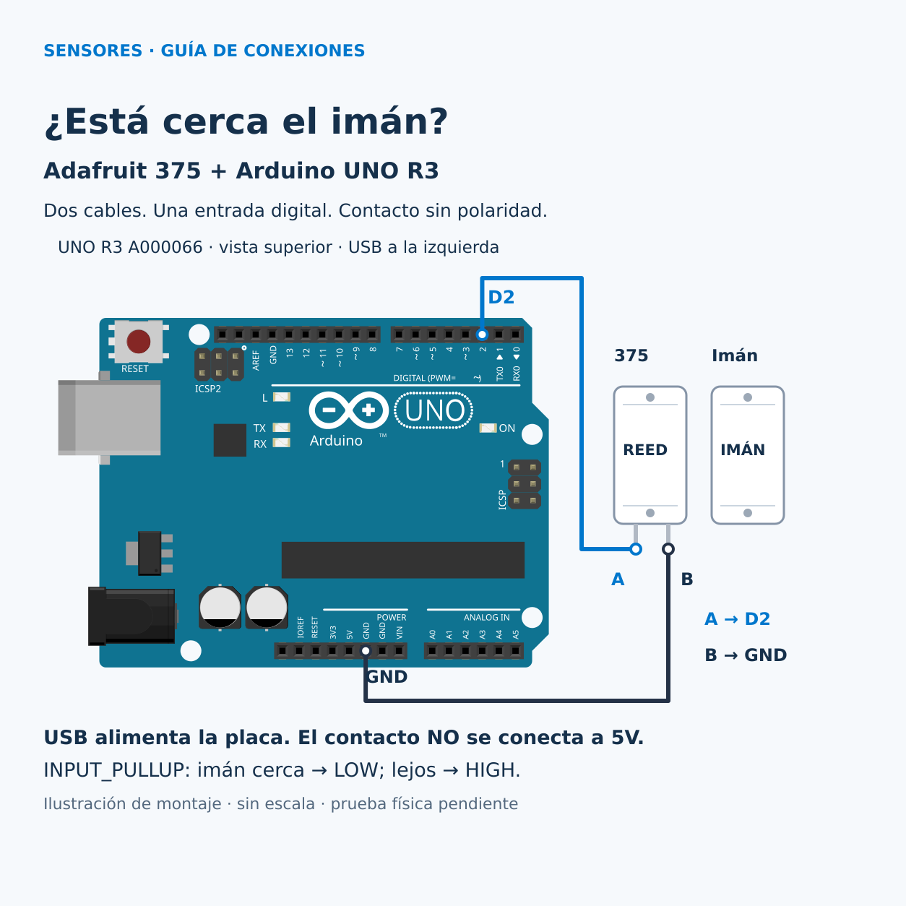

# Elegir un sensor: contacto magnético Adafruit 375

Por Ernesto Leal · Halifar Electronic Tech.

¿Cómo convierte un contacto la cercanía de un imán en un dato digital? Esta práctica enseña a identificar modelo, alimentación y señal antes de conectar. Requiere reconocer GND, cargar un sketch y usar el monitor serie. El contacto magnético es un ejemplo del recorrido de sensores; no presupone disponer ya del componente.

## Modelo, características y límites

Modelo educativo: **Adafruit Product ID 375**, contacto reed normalmente abierto en carcasa ABS, revisión de cables del **2 de junio de 2021**. Una mitad tiene dos hilos; la otra contiene el imán y no tiene conexión eléctrica. No tiene polaridad. La ficha describe cierre con el imán a menos de 13 mm y lista 15 mm como distancia máxima: no se interpreta como un umbral calibrado ni como precisión. Acerca las caras largas paralelas, empieza con unos 5 mm y comprueba el cierre antes de fijarlo. La orientación magnética, alineación y tolerancias afectan la actuación.

Es un interruptor pasivo: detecta proximidad del imán; no mide distancia ni identifica personas. Tampoco distingue cable cortado de contacto abierto. No usar este ejercicio como sistema de seguridad.

## Materiales y software

- Arduino UNO R3 **A000066**, ATmega328P, lógica de 5 V.
- Adafruit 375 en la revisión descrita, con sus extremos para prototipado e imán suministrado.
- USB de datos y ordenador. Si los extremos recibidos no encajan en los conectores hembra de UNO, dos adaptadores adecuados aislados; no dejar uniones de cobre expuestas. No hace falta protoboard.
- Arduino IDE con Arduino AVR Boards **1.8.6**, placa Arduino UNO. Los ejemplos no requieren bibliotecas externas.

## Alimentación y conexión

Desconecta USB antes de cablear. La placa se alimenta solo por USB. El contacto no tiene VCC y **no se conecta al pin 5V**. La resistencia interna activada por `INPUT_PULLUP` lleva D2 hacia la alimentación lógica de UNO; al cerrar, el contacto lleva D2 a GND. Nunca configures D2 como salida en este montaje.

| Red | Origen | Destino | Identificación |
|---|---|---|---|
| CONTACTO | UNO D2, PD2 | Hilo A del 375 | Azul en la ilustración |
| GND | UNO GND del cabezal POWER | Hilo B del 375 | Oscuro en la ilustración |

A y B son etiquetas didácticas de los extremos libres; no son marcas del fabricante ni colores obligatorios. Los hilos pueden intercambiarse. Usa el GND del bloque POWER señalado, sin confundirlo con VIN. El diagrama muestra la placa desde arriba, con USB a la izquierda y los conectores digitales arriba. Coloca el contacto en el marco y el imán en la parte móvil, caras largas paralelas. No hay alimentación externa ni un IC adicional que precise desacoplo: se conserva el desacoplo de UNO. Para esta prueba usa solo el cable suministrado, sin prolongaciones largas.



**Ilustración de montaje, sin escala. No es una fotografía ni una prueba física.** Los cables parten del centro de los terminales definidos en la pieza UNO, con conexiones guardadas en [conexiones.json](diagramas/conexiones.json). El dibujo del 375 representa sus dos mitades y los extremos libres de sus hilos; no expone su interior.

## Instalación y ejecución

1. Con USB desconectado, conecta ambos hilos según la tabla.
2. Conecta USB, selecciona Arduino UNO y su puerto en Arduino IDE.
3. Abre [lectura_minima.ino](src/lectura_minima/lectura_minima.ino) dentro de su carpeta homónima, verifica y carga.
4. Abre el monitor a **9600 baudios**. Aleja el imán: se espera `1`. Acércalo y alinéalo: se espera `0`.
5. Para el caso de una puerta, carga [contacto.ino](src/contacto/contacto.ino). El aviso describe el estado del contacto; solo podrás inferir “puerta cerrada” si el imán quedó montado correctamente.

## Código explicado

`pinMode(2, INPUT_PULLUP)` habilita la resistencia interna y evita una entrada flotante. `digitalRead(2)` devuelve HIGH o LOW. `Serial.println` muestra un valor por línea. `delay(100)` separa las lecturas aproximadamente 100 ms; no elimina rebotes ni garantiza capturar movimientos breves. En el segundo sketch, `PIN_CONTACTO` conserva el número de pin, `if` distingue ambos estados y `F()` conserva los textos en memoria de programa en AVR.

La lectura HIGH significa contacto abierto o cable desconectado; LOW significa contacto cerrado hacia GND. Al cerrar no hay cortocircuito directo de 5V a GND: la corriente pasa por el pull-up interno. El ejemplo oficial de Arduino documenta este mismo patrón de entrada D2 a GND.

## Resultado esperado y diagnóstico

Ejemplo esperado, **no medido**:

```text
IMAN LEJOS o cable desconectado: contacto abierto
IMAN CERCA: contacto cerrado
```

Si siempre ves abierto, revisa GND, D2 y la alineación del imán. Si siempre ves cerrado, desconecta USB y comprueba que no hayas unido los dos hilos o puenteado D2 a GND. Con el sensor separado de la placa puedes comprobar continuidad al acercar y alejar el imán. Alrededor del punto de actuación puede alternar por vibración o rebote: no cuentes eventos sin añadir y verificar antirrebote. Si no hay texto, revisa puerto, cable de datos y baudios. Como reto, explica por qué un cable cortado produce el mismo dato que un imán lejano.

## Pruebas y fuentes

Consulta [resultados y límites](pruebas/RESULTADOS.md). La compilación no demuestra funcionamiento físico. Quedan pendientes montaje real, continuidad, actuación, rebotes y ejecución del monitor con hardware.

Fuentes primarias consultadas el **26 de octubre de 2026**:

- [Adafruit 375: modelo, revisión y características](https://www.adafruit.com/product/375).
- [Arduino UNO R3: pinout A000066, revisión 6 octubre 2022](https://docs.arduino.cc/resources/pinouts/A000066-full-pinout.pdf).
- [Arduino: Input Pullup Serial](https://docs.arduino.cc/built-in-examples/digital/InputPullupSerial/), ejemplo de Scott Fitzgerald en dominio público, base del patrón de lectura empleado.

## Créditos del diagrama

La pieza UNO R3 procede de Fritzing Parts, autor de la definición: althaus; gráficos generados por brd2svg. Se adaptó la posición y escala de la pieza y se añadieron el contacto, las conexiones y las etiquetas. El diagrama derivado se distribuye bajo [CC BY-SA 3.0](https://creativecommons.org/licenses/by-sa/3.0/), según la [licencia de Fritzing Parts](https://github.com/fritzing/fritzing-parts/blob/master/LICENSE.txt). Este crédito y licencia corresponden al diagrama, sin asignar una licencia general al repositorio.

[Índice de sensores](../../README.md) · [Instagram](https://www.instagram.com/halifarelectronictech/) · [Facebook](https://www.facebook.com/halifarelectronictech/)
