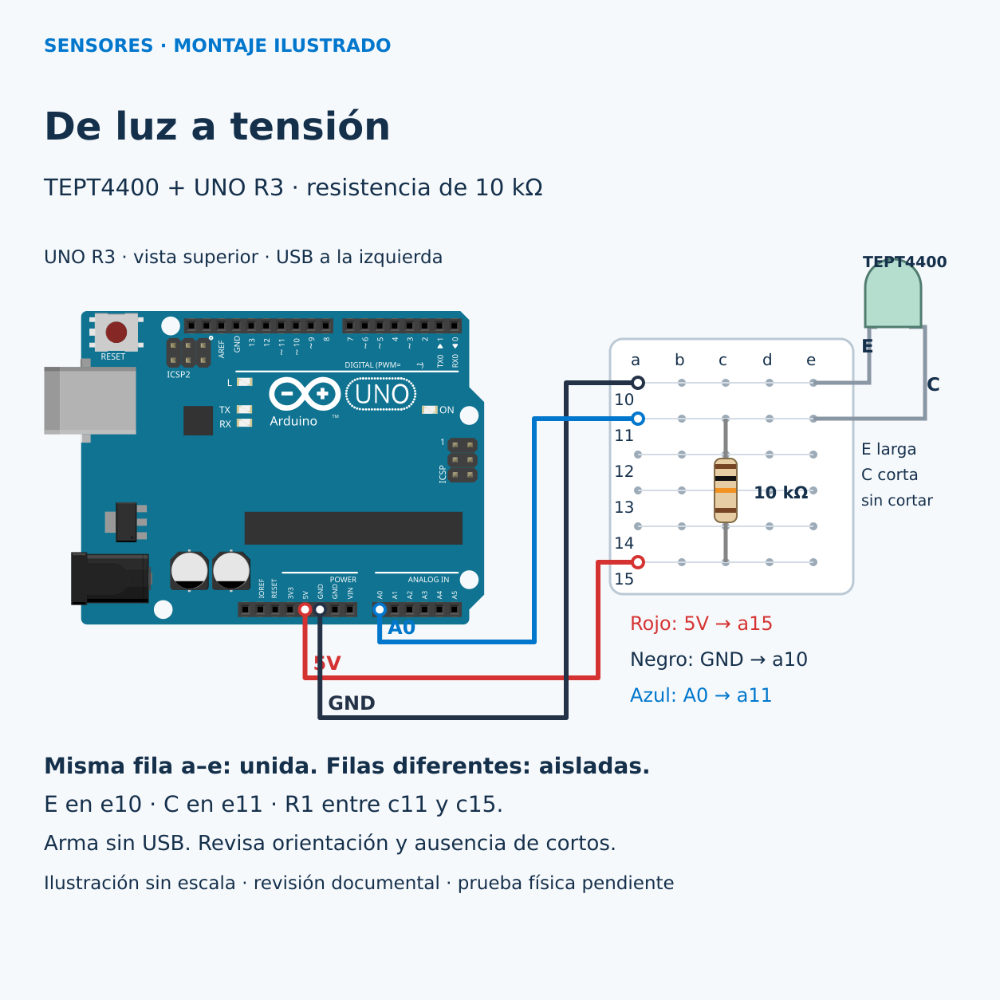

# Señales analógicas y digitales: de la luz a una decisión

**Por Ernesto Leal · Halifar Electronic Tech**

¿Cómo convertir una variación de luz en un aviso? Leeremos un valor con el ADC y lo compararemos con un umbral. Necesitas conocer variables, `setup`, `loop` y el Monitor serie. Al terminar podrás explicar la diferencia entre una medida relativa y una decisión sí/no.

## Modelo y límites

Usamos el **Vishay TEPT4400**, fototransistor NPN de luz ambiente, encapsulado T-1 de dos terminales, sin módulo. La ficha 81341, rev. 1.8 del 30-06-2016, define un máximo absoluto VCE de 6 V e IC de 20 mA; no son condiciones recomendadas de medida. Tiene sensibilidad máxima alrededor de 570 nm y variación entre unidades. No es un luxómetro calibrado.

La placa es **Arduino UNO R3 A000066**, con ATmega328P y ADC de 10 bits. Alimentación de placa: USB; circuito externo: 5 V del UNO mediante resistencia. El sensor no tiene alimentación VCC separada ni salida lógica digital. A0 recibe una tensión entre GND y 5 V; `analogRead` produce 0..1023 con la referencia predeterminada del UNO. La decisión binaria ocurre en software, sin usar `digitalRead` ni un umbral eléctrico de entrada digital.

## Materiales

- UNO R3 A000066 y cable USB de datos.
- TEPT4400 original de dos patas, identificable antes de cortar.
- Resistencia axial 10 kΩ, 1 %, 0,25 W (marrón, negro, naranja, marrón).
- Protoboard con filas a–e unidas horizontalmente y filas sucesivas aisladas; tres cables.
- Arduino IDE 2.x o Arduino CLI; core `arduino:avr` 1.8.6. Sin librerías adicionales.

## Montaje físico



Ilustración sin escala; no es una fotografía ni prueba de hardware. La guía completa el montaje que las láminas conceptuales iniciales dejan pendiente. [Datos editables y redes](diagramas/conexiones.json).

Desconecta el USB antes de montar. Orienta el TEPT4400 de frente como el dibujo dimensional de la página 4 de su ficha: lente arriba, patas abajo, **E a la izquierda, pata larga; C a la derecha, pata corta**, antes de cortar. Separa suavemente las patas para llevar E a e10 y C a e11. No deduzcas polaridad usando reglas para LED ni sustituyas por un sensor parecido. Si las patas fueron cortadas y no puedes identificar E/C, usa otra pieza identificada.

| Elemento | Origen | Destino | Red |
| --- | --- | --- | --- |
| Cable rojo | UNO 5V | a15 | 5V |
| Cable negro | UNO GND junto a 5V | a10 | GND |
| Cable azul | UNO A0 | a11 | SEÑAL |
| Sensor E | pata larga identificada | e10 | GND |
| Sensor C | pata corta identificada | e11 | SEÑAL |
| Resistencia R1 | c15 | c11 | entre 5V y SEÑAL |

Cada fila a–e forma una red; 10, 11 y 15 están aisladas entre sí. Los rieles laterales no se usan. El UNO aparece desde arriba con USB a la izquierda. No conectar VIN ni una fuente externa. Evita que las patas del sensor se toquen. Con el circuito desconectado comprueba continuidad dentro de cada fila y que 5V–GND no estén en cortocircuito.

R1 convierte corriente en caída de tensión y limita la corriente a 5 V / 10 kΩ = 0,5 mA, incluso con el transistor conduciendo intensamente. Aumentar la luz aumenta conducción y baja la tensión de C/A0; tapar el sensor la eleva. Esto es una inferencia del circuito, no una medición. La resistencia disipa como máximo 2,5 mW. Es un sensor pasivo sin IC externo: no necesita un desacoplo de alimentación externo para esta práctica lenta; se conserva el desacoplo original del UNO.

## Instalación y ejecución

Abre primero [minimo.ino](src/minimo/minimo.ino), selecciona Arduino UNO y el puerto de tu placa, verifica y carga. Abre el Monitor serie a **9600 baudios**. Tapa y destapa la lente sin tocar los conductores; anota ambos intervalos. Después abre y carga [umbral.ino](src/umbral/umbral.ino).

Con CLI, desde esta carpeta:

```sh
arduino-cli compile --fqbn arduino:avr:uno src/minimo
arduino-cli compile --fqbn arduino:avr:uno src/umbral
```

Para cargar usa el puerto real que muestre tu IDE o `arduino-cli board list`; no copies un puerto inventado.

## Cómo funciona el código

En el mínimo, `SENSOR = A0` elige el terminal cableado. `Serial.begin(9600)` abre la comunicación. `analogRead` toma una muestra, `println` la muestra y `delay(200)` deja observar cinco valores por segundo. No se activa el pull-up interno, porque alteraría el circuito.

El ejemplo de aviso conserva la lectura y añade `UMBRAL = 600`. `lectura >= UMBRAL` produce `true` o `false`. `digitalWrite` enciende el LED integrado si está oscuro; no hay LED externo. `print` conserva el valor en la misma línea y `println(oscuro)` imprime 1 o 0. El umbral 600 es didáctico, sin valor universal. Elige uno entre tus intervalos de luz y sombra; si no se separan, cambia la iluminación antes de sacar conclusiones. Cerca del umbral puede parpadear, porque este ejemplo aún no implementa histéresis.

## Resultado esperado y ejercicio

Más luz debe reducir la lectura; al taparlo debe aumentar. Ejemplo **simulado**, no medición: `300 oscuro=0`, `700 oscuro=1`. La igualdad, `600 oscuro=1`, también activa el aviso. Ni el ADC ni este umbral expresan grados o lux.

Reto: registra los intervalos en dos ubicaciones, ajusta el umbral y explica por qué una lectura numérica contiene más información que el estado binario. Siguiente tema previsto: PIR y detección de movimiento, todavía sin guía en este avance. [Tema anterior: elegir un sensor](../003-elegir-sensor-contacto/README.md).

## Diagnóstico

- Siempre cerca de 1023: revisa E/C, GND, sensor tapado o falta de conducción.
- Siempre cerca de cero: revisa cortos en fila 11, resistencia y luz excesiva/saturación.
- Valores erráticos: revisa continuidad de A0 y GND, contactos y parpadeo de la iluminación.
- Texto ilegible: configura 9600 baudios y selecciona el puerto correcto.
- No uses lectura/1023 como calibración de lux; el espectro, la geometría y cada pieza influyen.

## Validación y fuentes

[Resultados y límites de pruebas](pruebas/RESULTADOS.md). Ambos programas se compilaron para UNO; montaje, lecturas y LED físicos pendientes. No se ha medido precisión ni calibrado iluminación.

Fuentes primarias consultadas el 5 de noviembre de 2026:

- [Vishay TEPT4400, ficha 81341](https://www.vishay.com/docs/81341/tept4400.pdf), rev. 1.8, 30 junio 2016; dibujo 6.544-5054.01-4, issue 5, 28 julio 2014, página 4.
- [Pinout oficial UNO R3 A000066](https://docs.arduino.cc/resources/pinouts/A000066-full-pinout.pdf), actualización 6 octubre 2022.
- [Arduino analogRead](https://docs.arduino.cc/language-reference/en/functions/analog-io/analogRead/).

La pieza UNO R3 procede de [Fritzing Parts](https://github.com/fritzing/fritzing-parts), definición de althaus, gráficos brd2svg. Se adaptaron posición y escala y se añadieron protoboard, sensor, resistencia y cables. El diagrama derivado se distribuye bajo [CC BY-SA 3.0](https://creativecommons.org/licenses/by-sa/3.0/), según la [licencia de Fritzing Parts](https://github.com/fritzing/fritzing-parts/blob/master/LICENSE.txt). Esta licencia corresponde al diagrama; no asigna una licencia general al repositorio.

[Índice de sensores](../../README.md) · [Instagram](https://www.instagram.com/halifarelectronictech/) · [Facebook](https://www.facebook.com/halifarelectronictech/)
