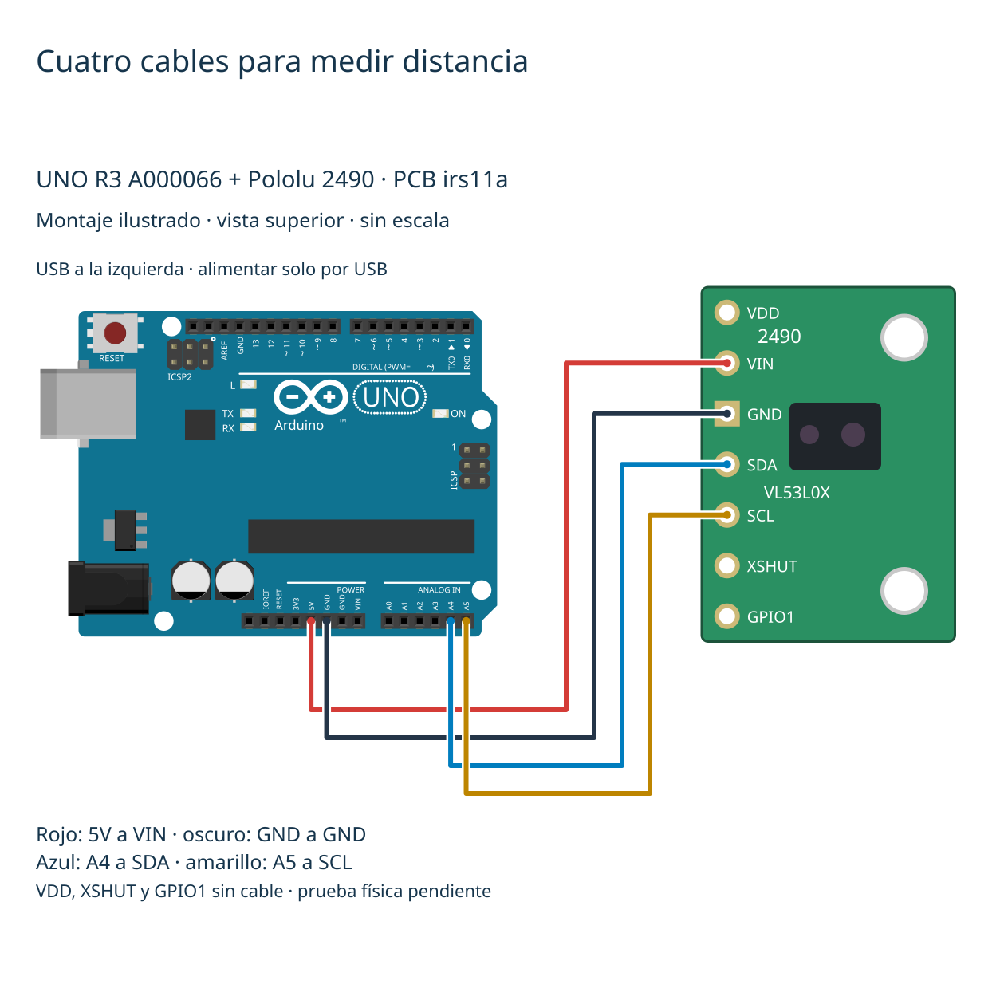

# Distancia con VL53L0X: Pololu 2490 y Arduino UNO R3

¿Cómo convertir una distancia en un aviso por consola? Esta guía mide en milímetros y avisa cuando el objeto está a menos de 200 mm. Es un modelo educativo documentado; no requiere disponer de un montaje previo. Prerrequisitos: Monitor serie, variables y condicionales. La detección PIR de movimiento sigue siendo un tema distinto pendiente.

## Modelo y límites

Usamos exclusivamente **Pololu 2490, PCB irs11a, con VL53L0X**, y **Arduino UNO R3 A000066 con ATmega328P**. El carrier incorpora regulador a 2.8 V y adaptación de nivel para SDA/SCL. No sustituirlo por un módulo genérico ni por otros sensores con PCB parecida. El tiempo de vuelo mide la distancia a partir de pulsos infrarrojos. La resolución de 1 mm no significa precisión de 1 mm. El alcance anunciado de hasta 2 m depende del blanco, luz y configuración: se debe verificar en cada aplicación. Consumo típico del carrier: 20 mA, picos de 40 mA según condiciones. No es un dispositivo de seguridad ni una medida propia de rendimiento.

## Materiales y alimentación

UNO R3 A000066, Pololu 2490 con tira de terminales soldada, cuatro cables macho-hembra y USB de datos. Sin protoboard ni alimentación externa. Con USB retirado, conecta los cables a la placa y al carrier. Pon el carrier sobre soporte aislante, con la cara del sensor visible y su campo óptico libre. Retira la lámina protectora si está presente, sin alterar las ventanas ópticas.



[Vector editable](diagramas/montaje.svg) · [Terminales y redes](diagramas/conexiones.json)

El vector simplifica componentes internos y conserva los terminales funcionales. Vista superior de ambas placas: USB del UNO a la izquierda; en el carrier, fila de siete contactos a la izquierda y dos taladros a la derecha. De arriba abajo: VDD, VIN, GND (pad cuadrado), SDA, SCL, XSHUT, GPIO1. No confundir con la vista inferior del dibujo mecánico. Sin escala común entre placas. Cruces de cables sin unión; los halos blancos muestran qué cable pasa por encima.

| UNO R3 | Pololu 2490 | Color | Red |
|---|---|---|---|
| 5V | VIN | Rojo | Alimentación de 5 V |
| GND junto a 5V | GND | Oscuro | Masa común |
| A4 | SDA | Azul | Datos I²C |
| A5 | SCL | Amarillo | Reloj I²C |

Usa A4/A5 del conector analógico; sus duplicados SDA/SCL del UNO pertenecen a las mismas redes y aquí quedan sin cable. Deja **VDD, XSHUT y GPIO1 desconectados**. VDD es salida regulada de 2.8 V con esta alimentación. XSHUT y GPIO1 no tienen adaptación a 5 V. No unirlos a 5V ni añadir cables a ellos.

VIN a 5 V está dentro del rango documentado; el I²C del carrier se adapta al nivel de VIN, compatible con el UNO de 5 V. Conserva desacoplo y resistencias incorporadas: el esquema del carrier incluye C1/C3 de 1 µF, C2/C5 de 0.1 µF y C4 de 4.7 µF. No hace falta añadir resistencias pull-up para este único carrier con cables cortos. La verificación aquí es documental y del dibujo; no demuestra soldadura, continuidad real ni tensión medida. Antes de conectar USB, verifica terminal a terminal y ausencia de puentes de estaño entre VIN y GND.

## Instalación y prueba

Arduino AVR Boards **1.8.6**, FQBN `arduino:avr:uno`; biblioteca **VL53L0X de Pololu 1.3.1**. Instálala desde el gestor de bibliotecas y selecciona esa versión. Abre [ejemplo.ino](ejemplo/ejemplo.ino), selecciona Arduino UNO y carga al puerto correspondiente. Abre Monitor serie a **9600 baudios**.

`Wire.begin()` activa I²C en A4/A5; `Wire.setClock(100000)` fija 100 kHz. `setTimeout(500)` limita la espera de medición. `init()` comprueba inicialización: si falla, el programa muestra un error y se detiene. La dirección inicial de siete bits es **0x29**; la biblioteca la usa por defecto. `startContinuous(100)` solicita una lectura aproximadamente cada 100 ms. `readRangeContinuousMillimeters()` devuelve milímetros. El programa descarta timeout y valores de 8190 mm o superiores como filtro educativo; esto no sustituye la validación detallada de estado del API de ST. La biblioteca de Pololu tiene comprobaciones de error limitadas: una cifra impresa no garantiza una medida válida bajo cualquier condición.

El condicional `mm < 200` genera el aviso «Objeto cercano». Cambia ese umbral a 300 mm como ejercicio y comprueba qué sucede justo en el límite. Coloca un blanco plano a 100, 200 y 400 mm, con regla y luz interior estable. No tapes el sensor ni interpretes un timeout como distancia cero. Ejemplo de formato esperado, **sin ejecución en hardware**:

```text
Distancia (mm): 150
Objeto cercano
Distancia (mm): 250
```

Si aparece ERROR, desconecta y coteja VIN/GND y A4/A5; confirma modelo y soldaduras. Ante TIMEOUT o fuera de rango, acerca el blanco, revisa luz, tamaño y cubierta protectora. No cambies cables con alimentación conectada. No se verificó una lectura real ni se calibró el sensor.

## Validación y fuentes

[Resultado de compilación](pruebas/RESULTADOS.md). Montaje físico, medidas de alimentación, ejecución en placa, precisión y validación del umbral permanecen pendientes. La imagen es una ilustración de montaje, no una fotografía ni una prueba física.

Fuentes primarias consultadas para este recurso:

- [Carrier y tabla de conexiones de Pololu](https://www.pololu.com/product/2490).
- [Dimensiones, PCB irs11a, dibujo del 30-07-2024](https://www.pololu.com/file/0J1194/vl53l0x-vl53l1x-vl53l3cx-vl53l4cd-carrier-dimension-diagram.pdf).
- [Esquema del carrier](https://www.pololu.com/file/0J1188/vl53l0x-vl53l1x-vl53l3cx-vl53l4cd-time-of-flight-sensor-schematic.pdf).
- [Biblioteca oficial, versión 1.3.1](https://github.com/pololu/vl53l0x-arduino/tree/1.3.1).
- [Pinout oficial UNO R3 A000066](https://docs.arduino.cc/resources/pinouts/A000066-full-pinout.pdf).

La placa Arduino del vector procede de Fritzing, pieza arduino_Uno_Rev3, autor althaus, versión 5; CC BY-SA 3.0. El diagrama derivado se distribuye bajo la misma licencia. La representación del carrier se construyó a partir de dimensiones y terminales documentados; no reproduce una fotografía de Pololu.

[Índice de Sensores](../../README.md) · [Instagram de Halifar](https://www.instagram.com/halifarelectronictech/) · [Facebook de Halifar](https://www.facebook.com/halifarelectronictech/)
